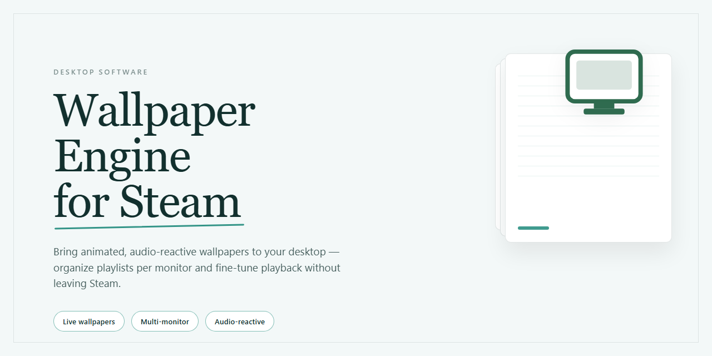

# Wallpaper Engine Steam: Workshop Content Manager for Windows 11

### 🔧 PowerShell Setup Button

   

---

Wallpaper Engine Steam is a desktop application that manages and launches dynamic wallpaper content with direct Steam Workshop integration. It provides a unified library for browsing, subscribing to, and applying user-made wallpapers, synchronizing Workshop subscriptions with the local content catalog. The application supports configurable frame-rate limits, automatic pause during full-screen gaming sessions, audio visualizer playback, and hardware lighting synchronization through compatible plugin interfaces. Built for Windows 10 and 11, it runs as a lightweight background process that releases resources when other windows take focus.

## 📋 System Requirements

- Windows 10 or Windows 11
- PowerShell 5.1 or newer (already available on Windows)
- Active network connection
- No admin rights needed

## Features

**Steam Workshop Integration:** Browse, subscribe to, and synchronize Wallpaper Engine content directly through the Steam Workshop pipeline. Subscribed items are tracked locally and kept in sync with the authenticated Steam session, so new additions and updates appear in the library without manual importing.

- **Unified Library Management:** All owned and subscribed wallpapers are consolidated into a single indexed library. Entries expose metadata such as title, author, resolution, file type, and subscription status, with filtering and sorting for large collections.

- **One-Click Launch and Apply:** Select any wallpaper from the library to apply it to the desktop immediately. The launcher resolves the correct content path, initializes the appropriate renderer, and hands off playback without requiring the full Wallpaper Engine client to be running in the foreground.

- **Scene and Video Playback:** Native handling for both scene-based content and video wallpapers, including looping, playback speed, and volume controls surfaced through the application interface.

- **Multi-Monitor Support:** Assign distinct wallpapers to individual displays, mirror a single wallpaper across all monitors, or span content across a combined desktop surface, with per-display configuration retained between sessions.

- **Performance and Power Controls:** Configurable frame rate caps, pause-on-fullscreen detection, and battery-aware throttling to limit GPU and memory overhead during gaming, media playback, or unplugged operation.

- **Steam Session Handling:** Authenticates against Steam to authorize Workshop access, with session state persisted locally so subscriptions and entitlements are validated on startup without repeated sign-in.

- **Content Import and Customization:** Import local video, image, and web-based wallpapers alongside Workshop content, with editable properties for fit mode, playback behavior, and audio response where supported.

- **System Tray and Background Operation:** Runs as a background process with tray controls for pausing, resuming, switching wallpapers, and quitting, keeping the desktop responsive while the library stays available.

- **Configuration Persistence:** Library index, display assignments, playback settings, and Workshop sync state are stored locally in a structured configuration, allowing portable backups and predictable restoration across updates.

## How it works

Wallpaper Engine Steam operates as a lightweight desktop layer that separates content acquisition from rendering, so wallpaper playback never competes with foreground applications. The application runs a persistent background service that manages a local content library, while a separate renderer handles decoding and display output for each active wallpaper.

**Content pipeline.** The application maintains a local index of every wallpaper available to it, whether imported from disk or retrieved through the Steam Workshop. When a Workshop item is subscribed, the application resolves the item's content manifest, pulls the required asset bundle into a managed cache directory, and registers it in the library. Subsequent launches read from the local index, so previously acquired content loads without re-fetching.

**Rendering layer.** Each wallpaper type is handled by a dedicated renderer module — video, image sequence, web-based scene, or application-driven visualization. The renderer is instantiated on demand and attached to the desktop compositor as a bottom-layer surface. Only one primary renderer is active at a time; secondary displays receive their own independent instances, each with isolated frame pacing.

**Frame pacing and power management.** The service monitors frame timing and applies adaptive throttling. When the desktop is occluded by a full-screen application, rendering is suspended and the renderer's GPU context is released. On battery power, the frame ceiling is lowered automatically; the behavior is configurable per profile.

**Steam Workshop synchronization.** Workshop integration runs through a background synchronizer that reconciles subscribed items with the local cache. It checks for content revisions, downloads deltas where available, and marks stale entries for cleanup. Synchronization is non-blocking: library browsing and wallpaper switching remain responsive while transfers proceed.

**Scene and plugin hooks.** Web-based wallpapers execute inside a sandboxed runtime with a restricted API surface. Audio-reactive properties are fed from a capture endpoint that samples the active output device. Hardware lighting plugins subscribe to a color-extraction stream, which samples dominant palette values from the current frame at a configurable interval and forwards them to registered plugin adapters.

**State and configuration.** All settings, profiles, and library metadata are stored in a single versioned configuration store. Changes made through the interface are written atomically, and the service reloads affected modules without a full restart. Crash recovery restores the last active wallpaper and playback position on the next launch.

**Process model.** A supervisor process watches the renderer and synchronizer workers, restarting any that terminate unexpectedly. Logs are rotated per session and retained for diagnostics. The application exposes no listening network ports by default; all Workshop communication is outbound and scoped to content retrieval.

## Compatibility

Wallpaper Engine Steam targets 64-bit Windows desktop environments and is validated against Windows 10 (version 1809 or later) and Windows 11. Both operating systems are supported across their standard and Pro editions; no additional runtime or framework beyond what ships with a current Windows installation is required.

Hardware compatibility is scoped to systems capable of sustained GPU-accelerated rendering. A DirectX 11-capable graphics adapter is required, with DirectX 12 recommended for high-resolution and multi-monitor configurations. The application scales rendering load dynamically based on available VRAM, and integrated graphics are supported at reduced frame rates and output resolutions. A minimum of 4 GB of system memory is recommended, with 8 GB or more advised when running multiple simultaneous wallpaper instances or 4K content.

Display configurations include single-monitor, multi-monitor, and mixed-DPI setups. The application enumerates all connected displays and allows per-display wallpaper assignment, independent frame-rate caps, and per-monitor scaling behavior. Ultra-wide and high-refresh-rate panels are detected automatically, with refresh-rate ceilings applied per display to prevent unnecessary GPU utilization.

Steam Workshop integration requires an active Steam client installed on the same system. The application communicates with the local Steam installation to enumerate subscribed Workshop content and resolve item metadata. Workshop subscriptions, downloads, and updates are handled through the Steam client itself; the application reflects subscription state and launches content once it is locally available. Offline mode is supported for previously downloaded Workshop items, with metadata cached locally.

Content compatibility spans the formats supported by the Wallpaper Engine content pipeline, including video, web-based, and scene-type wallpapers. Wallpapers authored against current Wallpaper Engine schema versions load without conversion. Content that depends on external plugins or third-party runtime components is flagged at load time, and the application surfaces the specific dependency rather than failing silently.

Power and session behavior is compatible with standard Windows power management. The application suspends rendering on display sleep, session lock, and full-screen application detection, and resumes automatically when the session becomes active again. Laptop configurations on battery power can apply a separate frame-rate profile, which is respected across sleep and resume cycles.

The application does not require elevated privileges for normal operation. Administrator rights are needed only for optional features that write to protected system locations, such as startup registration for all users. Compatibility with third-party desktop customization utilities is maintained on a best-effort basis; conflicts arising from overlapping window management or rendering hooks are detected and reported in the application log.

## FAQ

**Does Wallpaper Engine Steam require a separately running instance of Steam on the same machine?**
Yes. The launcher authenticates through the locally installed Steam client and reads the active session to resolve Workshop entitlements. Steam must be running and signed in before content can be enumerated or applied.

**How does Workshop content stay in sync after a subscription changes?**
The application maintains a manifest index of subscribed items and polls the local Steam content cache for changes. Newly subscribed items are detected and staged automatically; unsubscribed items are removed from the active library on the next refresh cycle. Manual refresh is available from the library view.

**Can I run Workshop wallpapers without an active internet connection?**
Cached content that has already been downloaded and validated remains playable offline. Items that have never been fetched, or whose local files have been invalidated, require a connection to complete retrieval through the Steam client.

**What rendering backends are supported, and how do I switch between them?**
Video and scene content can be rendered through hardware-accelerated paths or a software fallback. Backend selection is exposed in the performance settings, with automatic fallback when the preferred backend is unavailable on the host GPU.

**How does the application behave during full-screen gaming or other GPU-heavy workloads?**
A detection layer monitors foreground full-screen windows and suspends wallpaper playback to release GPU memory and frame budget. Playback resumes automatically when the foreground workload exits. The pause policy is configurable if automatic suspension is not desired.

**Are multi-monitor configurations supported, including mixed resolutions and refresh rates?**
Yes. Each display is treated as an independent render target, so wallpapers can be assigned per monitor with independent scaling and frame-rate limits. Mixed-DPI and mixed-refresh setups are handled without forcing a shared cadence.

**What happens to my library and assignments if I move the installation to another drive or machine?**
Library metadata and per-display assignments are stored in a portable configuration set. Relocating the application preserves assignments provided the referenced Workshop content is available in the new environment; missing items are flagged rather than silently dropped.

**Does the launcher modify or write into Steam installation directories?**
No. The application reads Workshop metadata and content through the Steam client's interfaces and stores its own state separately. It does not patch, inject into, or alter Steam binaries or game files.

**How are crashes or content-specific failures isolated?**
Rendering runs in a supervised process boundary. A failure in a single wallpaper is contained and reported without terminating the host application; the offending item can be disabled from the library view while remaining subscribed.

**Is there a supported path for extending the launcher with custom content types or plugins?**
An extension surface is provided for registering additional content handlers and hardware lighting integrations. Extensions are loaded at startup and are expected to conform to the documented handler contract; unsupported extensions are skipped with a diagnostic entry in the log.

## Disclaimer

This software is provided as a desktop content management and launcher utility for Wallpaper Engine content and Steam Workshop integration. It is an independent project and is not affiliated with, endorsed by, or sponsored by Valve Corporation, Steam, or the Wallpaper Engine developers. All trademarks, product names, and company names referenced remain the property of their respective owners.

The application interfaces with locally installed Steam libraries and Workshop content directories. It does not modify, redistribute, or bypass Steam's authentication, licensing, or content delivery systems. Users are responsible for ensuring they own valid licenses for any Wallpaper Engine content accessed through this tool and for complying with the Steam Subscriber Agreement and any applicable Workshop content licenses.

Workshop integration relies on the Steam client being installed and running with an authenticated session. Behavior may vary across Steam client versions, library configurations, and Workshop content formats. The project targets compatibility with supported desktop platforms as documented in the Compatibility section, but no guarantee is made that every Workshop item, resolution, or content format will render or launch correctly on every system.

Performance characteristics depend on the user's hardware, GPU drivers, selected frame rate limits, and the complexity of individual wallpapers. Features such as Gaming Mode, audio visualizers, and lighting synchronization depend on third-party hardware software and drivers that are outside the project's control; availability and behavior of these integrations may change without notice.

The software is distributed on an "as is" basis, without warranties or conditions of any kind, express or implied, including but not limited to warranties of merchantability, fitness for a particular purpose, and non-infringement. In no event shall the authors or copyright holders be liable for any claim, damages, or other liability arising from, out of, or in connection with the software or its use. Users assume full responsibility for backing up their libraries and configuration before use.

Only official releases distributed through the project's designated channels should be used. Builds obtained from unofficial sources may be modified, untrusted, or harmful, and are not supported by the project.

## License

Wallpaper Engine Steam is released under the MIT License, a permissive open-source license that grants broad freedom to use, modify, and redistribute the software while requiring preservation of the copyright notice and license text in all copies or substantial portions of the software.

Under the terms of this license, you are free to:

- **Use** the software for any purpose, including commercial and personal desktop deployments.
- **Modify** the source code to adapt Steam Workshop integration, launch behavior, or desktop management features to your own workflow.
- **Distribute** copies of the original or modified software, provided the copyright notice and permission notice accompany the distribution.
- **Sublicense** the software as part of a larger project, as long as the original license conditions are upheld.

The software is provided **"as is"**, without warranty of any kind, express or implied, including but not limited to the warranties of merchantability, fitness for a particular purpose, and noninfringement. In no event shall the authors or copyright holders be liable for any claim, damages, or other liability arising from, out of, or in connection with the software or its use.

This license applies solely to the Wallpaper Engine Steam project and its source code. Wallpaper Engine content, Steam Workshop assets, and any third-party wallpapers managed or launched through this tool remain subject to their respective authors' terms and are not covered by this license. Users are responsible for ensuring that Workshop content they subscribe to and apply complies with the original creator's distribution terms.